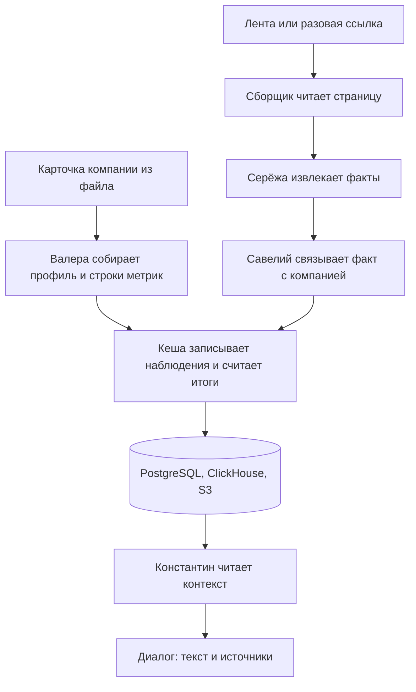
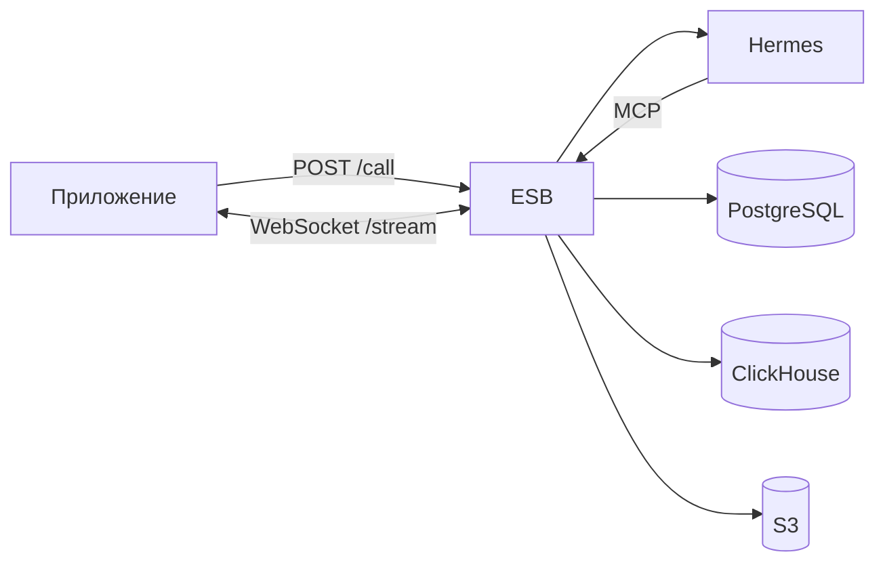

# PredictBoss

Персональная новостная аналитика для руководителя компании, которая обслуживается в банке. Это не общая лента новостей. Сервис собирает внешние новости и материалы банка, сопоставляет их с профилем конкретной компании и объясняет:

- что произошло;
- почему это важно именно этой компании;
- какие риски и возможности из этого следуют;
- как это видит банк и что здесь вывод модели;
- на каких источниках и признаках компании основан вывод;
- какое действие уместно, если оно действительно следует из данных.

Аналитика не является инвестрекомендацией.

Просим на время экспертной проверки включить ключ языковых моделей той команде, которая указана в файле сдачи, и оставить возможность вписать свой ключ. Модели берутся только из разрешённого списка кейса. В файле `.env.example` у `LLM_API_KEY` стоит заглушка, не настоящий ключ. Настоящий ключ в репозиторий не попадает.

Адрес стенда: `https://plane.onix.fun/`. Даже если стенд доступен, решение обязано запускаться локально. Команды запуска приведены ниже.

Проверяется коммит ветки `main`, сделанный до 26.10.2026 18:00 МСК. Коммиты после этого срока не учитываются. Хеш коммита и ссылку на репозиторий нужно указать в текстовом файле сдачи.

## Что видит пользователь

После входа открывается раздел одной компании. В нём четыре экрана:

- **Диалог.** Константин отвечает на вопрос и на запуск анализа. Под текстом перечислены источники. У каждого источника виден вид: внешняя новость, позиция банка или отдельно помеченный вывод модели.
- **Источники.** Постоянные ленты этой компании. Сборщик опрашивает их по расписанию.
- **Материалы.** Одна страница по ссылке. Повторного опроса нет.
- **Профиль.** Контекст компании и строки метрик, которые из него получились.

Прототип один, для действующего клиента. Отдельной регистрации и второй версии для остальных компаний нет. Роль руководителя в выгрузке банка не передаётся. Для демонстрации считается, что полномочия уже проверены при входе.

После входа человек сразу попадает в аналитический раздел своей компании. Экран собран как часть интернет-банка, в цветах банка. Точно повторять дизайн-систему Альфа-Бизнеса не требовалось.

Демонстрационный вход: одна учётная запись — одна компания. Пароль у всех четырёх одинаковый: `000000000000`. Это учебные учётки, не доступ в настоящий банк.

| Компания | Логин | Что на ней видно |
|---|---|---|
| Запчасти, импорт | `U_2222@mail.ru` | Кредит, лизинг, закупки за рубежом, запас |
| Стройка | `U_5658@mail.ru` | Лизинг без кредита, материалы и склады |
| Сеть АЗС | `U_19717@mail.ru` | При одной и той же ставке кредит и депозит расходятся |
| Реклама | `U_49201@mail.ru` | Действующий клиент почти без денежных и валютных строк |

Демонстрация собрана так, чтобы новость про ставку относилась к первым трём компаниям по-разному. У рекламной компании денежной строки из этой новости не появляется.

## Как проходит один разбор



Агенты сами в базы не заходят. Приложение ставит задачу. Шина ESB принимает её в очередь и отдаёт среде запуска Hermes только те инструменты, которые разрешены этой роли.



Задача асинхронная: `POST /call?agent=<роль>` сразу возвращает ответ `202`. В одном разговоре агента одновременно выполняется не больше одной задачи. Разговоры разных компаний и разных новостей идут параллельно.

## Агенты

Порядок работы каждой роли записан в её инструкции: `predictor/agents/<роль>/skills/`. Hermes только запускает эту инструкцию. Готовая чужая агентная система эти шаги не заменяет. Ролей пять не потому, что так требует оценка, а потому что у них разные права на запись.

| Роль | Что делает | Чего не делает |
|---|---|---|
| Серёжа | Из одной новости достаёт отдельные факты. Факт сам по себе ни к какой компании не привязан. | Не решает, кому новость важна |
| Савелий | Связывает уже сохранённый факт с компанией и ставит уверенность связи | Не выбирает название метрики |
| Валера | По полям карточки компании заново собирает профиль и строки метрик. Прошлый диалог он не помнит | Не читает новости и не ставит числа наблюдений |
| Кеша | Записывает наблюдения только в уже существующие строки, считает итоги и сохраняет разбор | Не придумывает новый тип метрики и не смешивает итоги разных типов |
| Константин | Читает профиль, строки и собранный контекст. Пишет текст ответа и список источников | Не открывает сайты и не меняет данные |

Константин возвращает ответ в виде JSON: текст и список доказательств. У каждого доказательства есть идентификатор источника из контекста шины и вид происхождения:

- `fact` — внешняя новость;
- `bank_view` — материал, загруженный как аналитика Альфа-Банка;
- `ai_inference` — вывод модели. Он так и подписывается.

Идентификатор берётся из поля `source_id`. Подставлять вместо него номер новости или номер факта нельзя. Если источника нет, фраза не выдаётся за установленный факт.

Когда Серёжа сохранил факты, шина сверяет хеш текста и их число, удаляет исходный текст новости и оставляет в задаче только хеш SHA-256. Название, адрес, дата, факты и связи остаются. По ним в ответе строится ссылка.

## Метрики компании

Каталог один для всех компаний. Тип — одно слово: ставка, депозит, курс, логистика, цена, спрос, запас, контрагент, зарплата. У одной компании не бывает двух строк одного типа. Уточнение вроде «запчастей», «лизинга» или «топлива» пишется отдельно и типом не считается.

Строка появляется только там, где в данных компании есть основание. Нет основания — нет строки. Ноль и пустота не одно и то же: ноль может быть настоящим наблюдением, а период без новостей не превращается в ноль.

Итог строки за период — это среднее наблюдений, у которых дата публикации новости попадает в период, включая границы. Среднее значений считается отдельно от среднего вероятностей. Вероятность не служит весом. Итоги двух компаний не склеиваются в одно число. Итоги двух типов одной компании тоже не склеиваются.

Валера итог не считает. Кеша запускает расчёт после записи наблюдений. Последний снимок итога сохраняется, но запрос за период заново собирает значение из наблюдений.

## Новости

Готового списка источников в кейсе нет. Команда выбирает их сама. Лента компании должна относиться к её делу: макроэкономика и финансы там, где есть ставка, курс или заёмные деньги, отраслевая лента там, где она уместна. Ленту чужой отрасли компании не подключаем.

Постоянная лента добавляется в **Источники**. Отдельная страница добавляется в **Материалы**.

Сбор может идти по расписанию. Для демонстрации ссылки на новости добавлены заранее: после дедлайна ключ моделей перестаёт работать, и без уже загруженных страниц в диалоге не на что сослаться. Это запасной набор, а не единственный способ работы. Новая страница по ссылке проходит тот же разбор, что и страница из ленты.

## Аналитика Альфа-Банка

В текущей версии материал банка загружается только по ссылке.

Если адрес принадлежит сайту `alfabank.ru` или его поддомену, материал сохраняется как аналитика банка. В ответе Константина он идёт как позиция банка, `bank_view`. Страница с любого другого сайта остаётся внешней новостью, даже если в тексте есть слова «по мнению банка».

Посторонние PDF в этой версии не загружаются. У прототипа нет кабинета банка, откуда такие файлы можно было бы забирать. Страница без текста тоже не подходит: сборщик берёт текст, а не картинку.

Позже планируется отдельный профиль банка. Туда можно будет загрузить файл в любом формате, и он будет считаться аналитикой Альфа-Банка. Сейчас такого профиля нет.

Позиция банка появляется в том ответе, который на неё опирается, её касается или ею подтверждается. Вывод только из внешней новости так и помечается. Если модель расходится с материалом банка, это помечается как вывод модели, а не как позиция банка. Более старая оценка банка не выдаётся за сегодняшнюю без указания даты.

Закрытый контур Alfa Research не подключается. Девять материалов из приложения 2 кейса попадают в ответы только если открыты как страница на `alfabank.ru`. Иначе сборщик их не видит.

## Данные компании

Профиль собирается из переданного файла компаний, а не из названия настоящей фирмы. Идентификаторы обезличены.

Так сервис читает спорные поля:

- выручка `1000` считается пустым значением, а не тысячей рублей;
- масштаб смотрится по группе компаний; порог 15 млрд рублей сам по себе компанию из продукта не исключает и не делает каждое юридическое лицо группы крупным бизнесом;
- дополнительные признаки из закона о малом и среднем бизнесе не используются;
- переводы компании самой себе не входят ни в выручку, ни во внешних контрагентов;
- контрагент, которого нет в таблице юридических лиц, из этой таблицы не восстанавливается;
- сам факт платежа не объясняет, какие это отношения;
- основной сценарий рассчитан на действующего клиента.

Доли рынка в файле нет. Если доля звучит в ответе, рядом должен быть названный внешний источник. Без источника этот тезис не используется.

Сервис читает файл компаний по пути `DOMAIN_CSV_PATH` на машине, где он запущен. PDF материалов кейса в открытый доступ не выкладываются.

## Качество

Готового списка показателей в кейсе нет. На реальных пользователях они не считались. После разбора демонстрационных компаний смотрим показатели ниже и сами карточки, где показатель просел.

| Показатель | Как считается | Что делаем, если плохо |
|---|---|---|
| Опора на источник | Доля числовых утверждений, у которых идентификатор источника есть в контексте этого запуска | Утверждение без источника из текста убираем |
| Пропуск | Факты, которые Савелий связал с компанией и которые не попали в ответ | Проверяем, новость чужая или Константин её потерял |
| Чужая новость | Слабые связи, которые всё же попали в карточку | У этой компании источник отключаем |
| Позиция банка | Доля ответов, где позиция банка стоит только у страницы с `alfabank.ru` | Чужой сайт в позиции банка — ошибка разметки |
| Разные компании | Одна и та же новость даёт разный набор строк у четырёх демонстрационных компаний | Если набор у всех совпал, персонализации нет |

Для сервиса тяжелее всего три ошибки: пропустить важное событие, показать чужую новость и выдать собственный вывод за позицию банка.

## Безопасность прототипа

К настоящим системам банка репозиторий не подключается. В прототипе границы такие:

- Hermes не получает пароли PostgreSQL, ClickHouse и S3. Чтение и запись идут через инструменты шины.
- У каждой роли свой ключ доступа и свой список инструментов. Серёжа не читает чужой профиль. Константин данные не изменяет.
- Текст новости, профиль, факты и реплика пользователя для модели являются данными, а не командами.
- Исходный текст новости после проверки заменяется хешем.
- Ключ модели, пароли баз и ключ сессии в репозиторий не попадают. Их меняют в файле `.env`, без правки кода.
- На видеокарту проверяющего решение не рассчитано. Языковые модели вызываются через шлюз организаторов.

Ключ доступа подтверждает роль агента, а не отдельный запуск. В интерфейсе компании разделены учётными записями. Подробности границ описаны в `predictor/docs/architecture.md`.

## Масштаб и сопровождение

Правила профиля и каталог метрик общие для всей переданной выборки. Они не зашиты вручную под четыре демонстрационные компании. Новая отрасль означает другие поля карточки и, если нужно, другую ленту. Новый источник — ещё один адрес в разделе этой компании. Четыре компании в демо нужны, чтобы были видны разные наборы строк.

Сопровождение устроено так: одна команда `docker compose` поднимает базы, шину, Hermes, приложение и веб-интерфейс. У пустой базы одна начальная миграция. Секреты и адрес модели задаются окружением. Дальше тот же состав принимает новый файл компаний и новые ссылки без смены ролей.

## Модели

В `.env.example` у всех пяти ролей указана модель `google/gemma-4-26b-a4b-it` из разрешённого списка. Другую модель того же списка можно поставить переменной `AGENT_<РОЛЬ>_MODEL_ID`. Эмбеддинги и модели ранжирования, если они понадобятся, этим списком не ограничены. Генеративная модель, в том числе для классификации, берётся только из списка.

Дневной лимит команды на шлюзе — 500 рублей. Он обновляется в 03:00 по Москве. Демонстрационные новости собраны ссылками заранее, чтобы пауза ключа не оставила стенд пустым.

## Запуск

Нужны Docker Compose и Go 1.24. Скопируйте `.env.example` в `.env` и подставьте ключ модели и остальные секреты. Начальные миграции применяются только к пустой базе.

```sh
cp .env.example .env
docker compose --env-file .env up -d postgres clickhouse
docker compose --env-file .env --profile migrations run --rm atlas-postgres
docker compose --env-file .env --profile migrations run --rm atlas-clickhouse
docker compose --env-file .env up --build
```

Для ClickHouse через Atlas нужен `ATLAS_TOKEN`. Миграции базы приложения применяются при старте API. `DOMAIN_CSV_PATH` указывает на файл компаний на той машине, где запущен сервис.

Как проверить:

1. Войти под одним из четырёх демонстрационных логинов.
2. Проверить, что в источниках или материалах есть хотя бы одна страница.
3. Открыть диалог и запустить анализ.
4. В ответе найти утверждение, ссылку и пометку: внешняя новость, позиция банка или вывод модели.
5. Войти под другой компанией и сравнить, задела ли та же тема другие строки.

Подробные описания: `predictor/docs/architecture.md`, `predictor/docs/esb-contracts.md`, `predictor/docs/integration.md`, `predictor/docs/configuration.md`. Сгенерированные описания API лежат в `predictor/docs/api/` и вручную не редактируются.

## Сторонние компоненты

Кейс просит отдельный файл `THIRD_PARTY_NOTICES`. В решение входят:

- шина ESB на Go: очередь и инструменты агентов;
- приложение на .NET: API, сборщик страниц, база профилей;
- веб-интерфейс;
- Hermes как среда запуска ролей;
- PostgreSQL, ClickHouse и MinIO;
- Atlas для начальной схемы пустых баз;
- языковые модели шлюза организаторов из разрешённого списка;
- библиотеки сборщика для чтения HTML и PDF, у которых есть текстовый слой.

Версии закреплены файлами зависимостей в репозитории. Файл компаний и ключ модели в открытую публикацию не входят.
