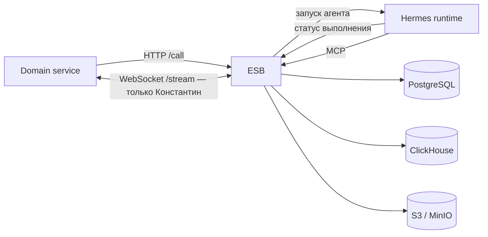

# Архитектура

## Контекст системы

ESB — единственная граница между агентами, Domain и хранилищами. Гермес запускает специализированные агенты. Агент получает только свой skill, конфигурацию и доступные MCP-инструменты.

Hermes не подключается напрямую к PostgreSQL, ClickHouse или S3 и не получает их credentials. Агенты читают и изменяют данные через инструменты MCP ESB. Отдельного profiles/S3-сервиса нет.

## Ответственность за данные

| Компонент | Источник истины |
| --- | --- |
| PostgreSQL | очередь и статусы вызовов, отдельные чаты агентов, чат Константина, ревизии профиля, источники новостей и настройки метрик компании |
| ClickHouse | новости, универсальные факты, связи фактов с компаниями, наблюдения метрик и тексты анализа |
| S3 | общий Markdown-профиль компании |

Настройки метрик принадлежат PostgreSQL. Наблюдения в ClickHouse ссылаются на `company_id` и `metric_id`; каталог и характеристики метрик там не дублируются. Факты универсальны, а связь факта с компанией хранится отдельно.

Итоги метрик не сохраняются: ESB вычисляет их по запросу из наблюдений и времени публикации новости. `metric_id` — непрозрачный UUID строки настроек PostgreSQL; `type_code` и характеристика остаются в PostgreSQL. Расчёт по одной метрике не требует `company_id`, а расчёт по компании читает каталог из PostgreSQL и вызывает расчёт для каждой строки отдельно.

## Поток вызова

1. Domain вызывает `POST /call?agent=<type>`; ESB сохраняет асинхронную задачу в PostgreSQL и отвечает `202` с `call_id`.
2. Фоновый обработчик ESB запускает нужный агент через Hermes и отслеживает его статус.
3. Hermes вызывает MCP ESB. ESB проверяет аргументы и сам читает или записывает PostgreSQL, ClickHouse и S3.
4. Domain читает статус или результат через `GET /call`; исключение — факты, доступные через `GET /call?data=facts`. `GET /call?agent=konstantin` по `companyId` возвращает историю и адрес WebSocket; если актуального анализа нет, этот же запрос ставит его в асинхронную очередь и отвечает `202`.

Валера сохраняет профиль и полный набор настроек метрик идемпотентным MCP-вызовом. Настройки фиксируются в PostgreSQL, Markdown — в S3. Ревизия профиля считается синхронизированной только после подтверждения обеих записей.

Константин использует актуальный профиль и предварительно агрегированные данные. `GET /call?agent=konstantin` возвращает состояние, адрес подписки и ограниченную страницу истории из PostgreSQL. Только Константин общается через WebSocket `/stream`; сообщения и доказательства сохраняются до отправки клиенту.

## Очередь и параллельность

Чат агента определяется парой `agent_type + scope_id`: например, Серёжа получает отдельный чат на `news_id`, остальные — на `company_id`. В одной беседе ESB допускает не более одного активного вызова. Вызовы разных бесед обрабатываются параллельно; глобальный лимит параллельности не задан, фактический предел определяется ресурсами ESB и Hermes. `max_history_messages: 0` означает пустую историю; значение `40` применяется, только если поле отсутствует в `agent.json`.

## Слои ESB по DDD

- `domain` — типы предметной области, статусы, события и порты.
- `application` — сценарии вызовов, аналитики, новостей и контекста компании.
- `infrastructure` — адаптеры Hermes, PostgreSQL, ClickHouse и S3.
- `presentation` — HTTP, WebSocket и MCP-контракты.

`cmd/esb` собирает зависимости и запускает HTTP-сервер и фоновый обработчик. Презентационные HTTP-обработчики сгруппированы по возможностям: вызовы, факты, состояние сервиса и поток Константина. MCP-регистрация разделена по профилю, фактам, метрикам и отчётам.

## Агенты и контракты

`predictor/agents/<agent>/agent.json` задаёт область чата и обязательные поля; `hermes.yaml` — runtime-настройки и MCP allowlist; `skills/*/SKILL.md` задаёт роль и строгий порядок работы. Имя типа агента совпадает с его skill.

Машинные контракты находятся в [каталоге API](api/README.md). Они генерируются командой `make docs` из Go-типов HTTP/WS, регистрации MCP-инструментов и текущих путей маршрутизации. Этот файл вручную описывает только архитектурные границы и намеренные решения.
