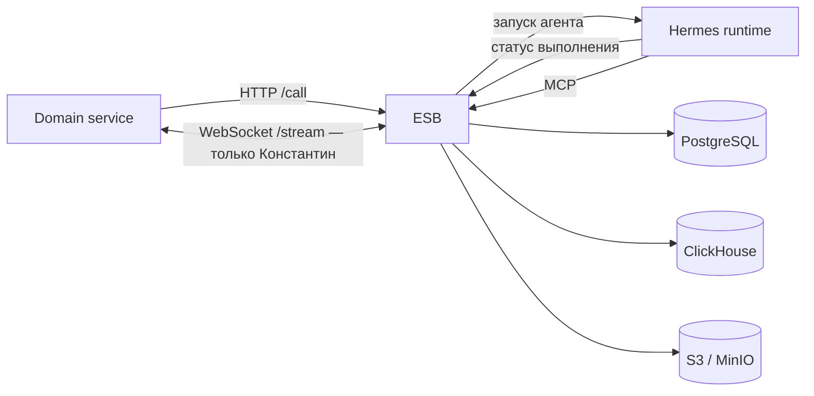

# Архитектура

## Контекст системы

ESB — единственная граница между агентами, Domain и хранилищами. Гермес запускает специализированные агенты. Агент получает только свой skill, конфигурацию и доступные MCP-инструменты.

Hermes не подключается напрямую к PostgreSQL, ClickHouse или S3 и не получает их credentials. Агенты читают и изменяют данные через инструменты MCP ESB. Отдельного profiles/S3-сервиса нет.

Compose запускает ESB после хранилищ и ожидает его healthcheck до старта Hermes, чтобы MCP endpoint был доступен при подключении агентов.

## Границы доверия

Domain HTTP и WebSocket используют `ESB_API_KEY`; MCP использует отдельный уникальный Bearer-токен для каждого агента. ESB выводит роль только из токена, закрепляет эту роль за MCP-сессией, публикует только разрешённые инструменты и повторно проверяет разрешение при прямом `tools/call`. Декларация `mcp_tools` в `agents/<type>/agent.json` сверяется с серверным allowlist при старте. Hermes отключает системные toolsets и оставляет только необходимые MCP-инструменты. Skills объявляют запросы, новости, профили, историю и результаты инструментов недоверенными данными. Это снижает риск prompt injection, но не гарантирует семантически корректное поведение любой модели.

| Агент | MCP-инструменты |
| --- | --- |
| Серёжа | `save_news_and_facts` |
| Савелий | `get_company_profile`, `get_facts`, `save_fact_company_links` |
| Валера | `get_company_metrics`, `save_company_profile_and_metrics` |
| Кеша | `get_company_profile`, `get_company_facts`, `get_company_metrics`, `save_metric_observations`, `calculate_all_metric_totals`, `save_company_analysis`, `get_company_report` |
| Константин | `get_company_profile`, `get_company_metrics`, `get_consultant_context` (только чтение) |

ESB проверяет структурные ограничения, принадлежность настроек метрик компании, метаданные сохранённых новостей и связи фактов с компанией и новостью при записи аналитики. Probability/confidence остаются оценками модели. Текущий MCP-токен удостоверяет тип агента, но не конкретный `call_id` или компанию; поэтому ролевую авторизацию нельзя считать изоляцией арендаторов. Полную защиту чтения профилей/метрик от подмены валидного `company_id` нельзя гарантировать без защищённого call-scoped контекста, передаваемого Hermes.

## Ответственность за данные

| Компонент | Источник истины |
| --- | --- |
| PostgreSQL | очередь и статусы вызовов, отдельные чаты агентов, чат Константина, ревизии профиля, источники новостей и настройки метрик компании |
| ClickHouse | метаданные новостей, универсальные факты, связи фактов с компаниями, наблюдения метрик, снимки рассчитанных итогов и тексты анализа |
| S3 | общий Markdown-профиль компании |

Настройки метрик принадлежат PostgreSQL. Наблюдения в ClickHouse ссылаются на `company_id` и `metric_id`; каталог и характеристики метрик там не дублируются. Факты универсальны, а связь факта с компанией хранится отдельно.

Каталог и настройки метрик существуют только в PostgreSQL: `company_metric_settings` хранит `metric_id`, `company_id`, тип, характеристику, единицу, описание и параметры; пара `(company_id, type_code)` уникальна. В ClickHouse наблюдения и снимки итогов содержат только `company_id`, `metric_id`, аналитические значения, периоды, ссылки и счётчики. Расчёт заново читает наблюдения с учётом времени публикации новости, возвращает результат и сохраняет последний снимок в `metric_totals`; характеристики и справочник не копируются. Для единичного расчёта владелец `metric_id` определяется по PostgreSQL.

## Очистка исходного текста новости

ClickHouse хранит метаданные новости в `news`, текст — отдельно в `news_content`, а подтверждение успешной обработки — в `news_processing`. ESB считает Серёжу завершившим вызов только после сверки маркера, источника, хеша текста, метаданных и количества сохранённых фактов. Затем ESB удаляет строку из `news_content` и в одной транзакции PostgreSQL заменяет исходный текст в теле вызова и сообщении чата на SHA-256. При неподтверждённой записи статус становится ошибочным, а текст остаётся для безопасного повтора. Повторная финализация идемпотентна.

Строка `news` сохраняется как аналитическая метаинформация: `news_id`, `source_id`, `source_url`, `material_kind`, `media_type`, `title` и `published_at`. На эти данные опираются API фактов, цитирование и фильтрация наблюдений по времени публикации. Факты, связи с компаниями, наблюдения, итоги и анализ при очистке текста не удаляются. Миграция ClickHouse разделяет исходную схему на метаданные и текст. Текст legacy-новостей без маркера обработки переносится, но не удаляется автоматически: один статус `completed` недостаточен, чтобы подтвердить полный набор результатов.

## Поток вызова

1. Domain вызывает `POST /call?agent=<type>`; ESB сохраняет асинхронную задачу в PostgreSQL и отвечает `202` с `call_id`.
2. Фоновый обработчик ESB запускает нужный агент через Hermes и отслеживает его статус.
3. Hermes вызывает MCP ESB. ESB проверяет аргументы и сам читает или записывает PostgreSQL, ClickHouse и S3.
4. Domain читает статус или результат через `GET /call`; исключение — факты, доступные через `GET /call?data=facts`. `GET /call?agent=konstantin` по `companyId` возвращает историю и адрес WebSocket; если актуального анализа нет, этот же запрос ставит его в асинхронную очередь и отвечает `202`.

Валера сохраняет профиль и полный набор настроек метрик идемпотентным MCP-вызовом. Настройки фиксируются в PostgreSQL, Markdown — в S3. Ревизия профиля считается синхронизированной только после подтверждения обеих записей.

Константин использует актуальный профиль и предварительно агрегированные данные. `GET /call?agent=konstantin` возвращает состояние, адрес подписки и ограниченную страницу истории из PostgreSQL. Только Константин общается через WebSocket `/stream`; сообщения и доказательства сохраняются до отправки клиенту.

## Очередь и параллельность

Чат агента определяется парой `agent_type + scope_id`: например, Серёжа получает отдельный чат на `news_id`, остальные — на `company_id`. В одной беседе ESB допускает не более одного активного вызова. Вызовы разных бесед обрабатываются параллельно на доступных runtime-экземплярах.

`HERMES_<TYPE>_INSTANCES` задаёт пул в формате `id=state@url;id=state@url`; состояния — `available`, `draining`, `unavailable`. `AGENT_<TYPE>_MAX_CONCURRENT_RUNS` задаёт лимит на каждый экземпляр. ESB до HTTP-вызова Hermes фиксирует `runtime_instance_id` вызова в PostgreSQL. Все ESB-процессы резервируют слоты через PostgreSQL advisory lock и считают занятые слоты по сохранённым активным вызовам, поэтому локальные счётчики не являются источником истины. Run ID уникален в пределах агента и закреплённого runtime, а не всей системы.

Все ESB-реплики должны использовать одинаковый список runtime ID, адреса, состояния и лимиты. Для масштабирования добавьте новую запись и Hermes-процесс с отдельным постоянным volume. Для вывода процесса сначала задайте `draining`: новые вызовы на него не назначаются, закреплённые продолжают опрашиваться. Удаляйте запись после завершения закреплённых вызовов. ESB не станет готовым, если активный вызов указывает на отсутствующий runtime. Compose по умолчанию запускает по два Hermes-процесса на агента, каждому назначен собственный volume.

Предел истории Hermes задаётся в `agents/<type>/agent.json`; `max_history_messages: 0` означает не передавать историю.

В `agent.json` задаётся `context_policy`: порог `compress_after_messages` и размер `batch_messages` управляют сжатием старой части истории только для контекста Hermes; `summary_max_bytes` ограничивает резюме, `summary_storage` указывает PostgreSQL. Compare-and-swap по курсору разговора защищает резюме от конкурентной перезаписи. При ошибке Hermes или сохранения резюме ESB продолжает обычный вызов с доступным контекстом; исходные сообщения остаются в PostgreSQL. Срок хранения сообщений каждого агента задаётся отдельно через `CLEANUP_MESSAGES_RETENTION_<TYPE>`, резюме — через `CLEANUP_CONTEXT_SUMMARY_RETENTION`. Для Константина оба значения по умолчанию `never`: сжатие применяется только к истории Hermes, Domain продолжает читать полную историю PostgreSQL порциями.

У всех Hermes-агентов общий провайдер `HERMES_MODEL_PROVIDER` и ключ `LLM_API_KEY`. Модель, `max_concurrent_runs`, `max_turns` и `reasoning_effort` настраиваются для каждого агента через `predictor/.env`; адрес провайдера, MCP и разрешённые инструменты находятся в `agents/<type>/hermes.yaml`. Образы MinIO и Atlas заданы непосредственно в Compose и не являются env-настройками.

Фоновая очистка ESB разделена на независимую сверку старых вызовов и retention-проход. `CLEANUP_STATUS_CHECK_INTERVAL` задаёт сверку с Hermes, `CLEANUP_RETENTION_CHECK_INTERVAL` — удаление старых данных. Общий PostgreSQL advisory lock сериализует проходы на нескольких экземплярах. Пачка каждой категории ограничена `CLEANUP_BATCH_SIZE`; сроки хранения задаются Go duration или `never`, а `0` считается неверной конфигурацией. Ошибка Hermes или хранилища не приводит к удалению вызова или новости.

Исходный текст обработанной новости удаляется только после подтверждения маркера, хеша, метаданных и количества фактов и только после `CLEANUP_PROCESSED_NEWS_TEXT_RETENTION` от `processed_at`. При частичном сбое текст остаётся для повтора. Необработанный текст ClickHouse может удаляться только после отдельного срока и для терминального вызова Серёжи; PostgreSQL сохраняет retry payload пока он нужен повторной обработке. Метаданные, факты и наблюдения получают отдельные политики; нужные для цитирования и расчётов метаданные остаются, пока сохранены ссылающиеся на них факты или наблюдения, а факты — пока на них ссылаются связи компаний или наблюдения. ClickHouse mutation выполняется с ожиданием применения и проверяется чтением `FINAL`.

## Слои ESB по DDD

- `domain` — типы предметной области, статусы, события и порты.
- `application` — сценарии вызовов, аналитики, новостей и контекста компании.
- `infrastructure` — адаптеры Hermes, PostgreSQL, ClickHouse и S3.
- `presentation` — HTTP, WebSocket и MCP-контракты.

`cmd/esb` собирает зависимости и запускает HTTP-сервер и фоновый обработчик. Презентационные HTTP-обработчики сгруппированы по возможностям: вызовы, факты, состояние сервиса и поток Константина. MCP-регистрация разделена по профилю, фактам, метрикам и отчётам.

## Агенты и контракты

`predictor/agents/<agent>/agent.json` задаёт область чата и обязательные поля; `hermes.yaml` — runtime-настройки и MCP allowlist; `skills/*/SKILL.md` задаёт роль и строгий порядок работы. Имя типа агента совпадает с его skill.

Машинные контракты находятся в [каталоге API](api/README.md). Они генерируются командой `make docs` из Go-типов HTTP/WS, регистрации MCP-инструментов и текущих путей маршрутизации. Этот файл вручную описывает только архитектурные границы и намеренные решения.
